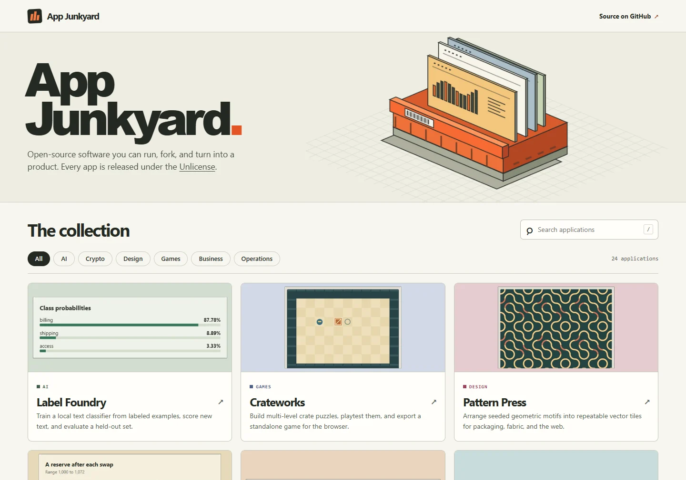

# App Junkyard

**24 working applications you can fork individually and turn into commercial products.** Run a text classifier, reconcile a crypto treasury, design a sprite, ship a browser game, or manage a client pipeline. Each app includes editable sample data, an app guide, domain tests and its own source directory.

[Open the live collection](https://ahpah-dev.github.io/app-junkyard/) · [Browse the apps](#applications) · [Read the Unlicense](LICENSE)



## Run the collection

Install **Node.js 24.13 or newer**. The applications and server use browser and Node standard libraries. A fresh clone needs no package installation, API credentials, or external database.

```sh
git clone https://github.com/ahpah-dev/app-junkyard.git
cd app-junkyard
npm start
```

Open **http://127.0.0.1:4173**. Select an app to edit its example or bring your own data. Each workspace has an **App guide** with instructions and supported formats. The AI tools train, score and evaluate data locally. The crypto tools work with supplied records and simulations. The game engines export playable HTML.

## Take one app

Open any app in the live collection and choose **Download starter** to get its runnable source as a ZIP. The [v1.0.0 release](https://github.com/ahpah-dev/app-junkyard/releases/tag/v1.0.0) includes all 24 individual downloads.

From the collection root:

```sh
npm run fork -- crateworks ../my-puzzle-studio
cd ../my-puzzle-studio
npm test
npm start
```

This creates a new, independent project containing Crateworks, its tests, the shared runtime, hosting instructions and the Unlicense. Its home page opens the editor directly. Use any app ID below. The destination must be a new directory. Omit the destination to create `forks/<app-id>/`.

## Applications

| AI | What you can do |
| --- | --- |
| [Corpus Curator](apps/corpus-curator) | Find conflicting labels and duplicates, then export reproducible training and test sets. |
| [Label Foundry](apps/label-foundry) | Train a multinomial Naive Bayes text classifier and measure held-out performance. |
| [Passage Rank](apps/passage-rank) | Rank documents using BM25 and inspect each matching term's contribution. |
| [Run Compare](apps/run-compare) | Compare paired model outputs against references and investigate regressions. |

| Crypto | What you can do |
| --- | --- |
| [Merkle Desk](apps/merkle-desk) | Generate SHA-256 inclusion proofs and verify them against a trusted root. |
| [Pool Bench](apps/pool-bench) | Replay swaps in a constant-product pool and inspect fees, reserves and execution prices. |
| [Treasury Ledger](apps/treasury-ledger) | Reconstruct wallet balances and reconcile against an independent snapshot. |
| [Vest Calendar](apps/vest-calendar) | Audit cliff vesting and forecast month-end balances with exact token quantities. |

| Design | What you can do |
| --- | --- |
| [Palette Loom](apps/palette-loom) | Generate perceptual color ramps, check text contrast and export design tokens. |
| [Pattern Press](apps/pattern-press) | Generate reproducible vector patterns for packaging, fabric or the web. |
| [Pixel Foundry](apps/pixel-foundry) | Draw transparent sprites with mirrored strokes and flood fill, then export scaled PNGs. |
| [Type Poster](apps/type-poster) | Lay out and export an editorial poster with fitted headlines and original geometric artwork. |

| Games | What you can do |
| --- | --- |
| [Branchline](apps/branchline) | Build branching narrative games with flags, conditional choices and playable HTML export. |
| [Crateworks](apps/crateworks) | Paint puzzle levels, playtest a campaign and export a standalone crate-pushing game. |
| [Flipbook](apps/flipbook) | Animate pixel sprites with onion skinning and export a packed PNG atlas. |
| [Map Kiln](apps/map-kiln) | Generate connected levels from a seed and customize exit placement. |

| Business | What you can do |
| --- | --- |
| [Pipeline Ledger](apps/pipeline-ledger) | Forecast weighted revenue and organize follow-ups by opportunity. |
| [Quote Foundry](apps/quote-foundry) | Price line items, apply discounts and tax, and download a client quotation. |
| [Receivables Desk](apps/receivables-desk) | Track invoice aging, record partial payments and reconcile outstanding balances. |
| [Retainer Book](apps/retainer-book) | Log client time, compare monthly allowances and calculate billable overage. |

| Operations | What you can do |
| --- | --- |
| [Incident Journal](apps/incident-journal) | Track incident milestones and export a timestamped response report. |
| [Room Roster](apps/room-roster) | Book rooms and equipment, detect conflicts and find the next open slot. |
| [Sprint Board](apps/sprint-board) | Plan delivery work, enforce work-in-progress limits and track blockers. |
| [Stockroom](apps/stockroom) | Track stock movements and open orders, then size replenishment in supplier pack multiples. |

Use the directory name in each link as the app ID. Running `npm run fork` without arguments also lists the available IDs.

## Develop and deploy

| Command | Outcome |
| --- | --- |
| `npm start` | Build a local catalog and serve it. Restart after editing source. |
| `npm test` | Run domain, catalog and account-isolation tests. |
| `npm run build` | Generate a deployable static site in `dist/`. |
| `npm run fork -- <id> [directory]` | Create a self-contained copy of one application. |

The live collection stores drafts in the browser. Self-hosted forks can enable the included SQLite account server for sign-in and private versioned backups. Customer billing, team collaboration and account recovery are product-specific extensions. [Hosting and account setup](HOSTING.md)

## Source layout

Each `apps/<id>/` contains its manifest, browser entry point, app guide and tests. Calculation-heavy apps keep reusable logic in separate modules. `shared/` holds common UI and editor helpers, `web/` supplies navigation and the workspace shell, and `server/` holds HTTP serving and optional account storage. Build and extraction scripts live in `scripts/`.

## License

App Junkyard is released under [the Unlicense](LICENSE). You may copy, modify, distribute and sell the software, including in a proprietary product.
